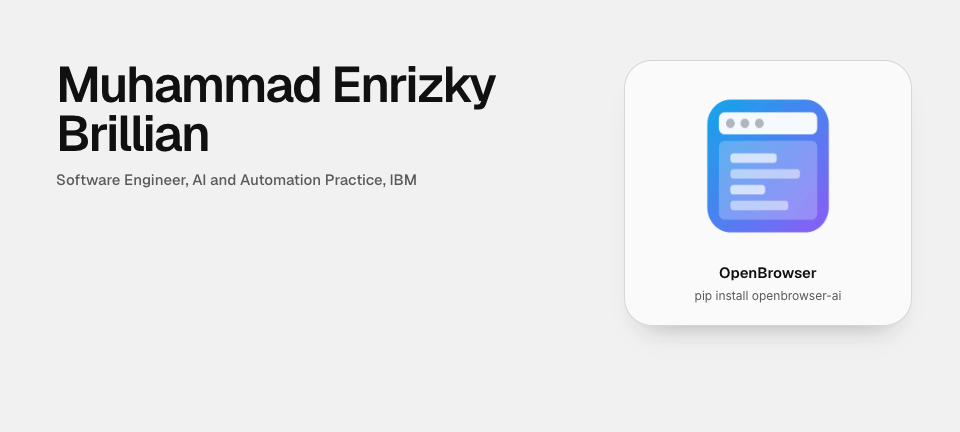
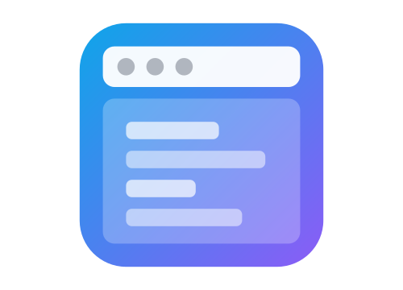

# Muhammad Enrizky Brillian

**AI / Machine Learning Engineer, Consultant at IBM Consulting** · Toronto, Canada

I build practical AI systems, from multi-agent applications and model serving to developer tools and data workflows. At IBM Consulting's AI and Automation Practice, I work with teams to define problems, evaluate solutions, and move useful systems toward pre-production.

[Portfolio](https://billy-enrizky.github.io/portfolio/) · [Current CV](https://billy-enrizky.github.io/portfolio/assets/Muhammad-Enrizky-Brillian-Software-Engineer-CV.pdf) · [LinkedIn](https://www.linkedin.com/in/enrizky-brillian/) · [Email](mailto:billy.suharno@gmail.com)

<picture>
  <source srcset="./assets/profile/profile-focus.png" media="(prefers-reduced-motion: reduce)">
  
</picture>

<a href="./assets/profile/profile-focus.png">View the static image</a>

## Technical focus

- **Languages**: Python, SQL, TypeScript, JavaScript, and Rust.
- **AI applications**: PyTorch, RAG, multi-agent systems, text-to-SQL, model evaluation, and structured outputs.
-  **Inference**: vLLM, SageMaker, Bedrock, FP8 weight compression, tensor parallelism, and multi-token prediction (MTP) speculative decoding.
-  **Agents and browser tools**: MCP, tool calling, Chrome CDP, and browser automation.
- **Application engineering**: FastAPI, Flask, React, Next.js, Node.js, testing, and observability.
- **Data platforms**: BigQuery, Snowflake, ETL, Pandas, and data modeling.
- **Cloud and infrastructure**: AWS, Azure, GCP, Docker, and Terraform.

## Experience

### AI / Machine Learning Engineer, Consultant, IBM Consulting

**May 2025 to present · AI and Automation Practice**

- Delivered a six-agent text-to-SQL system across five production databases in eight weeks. It reached 93% accuracy in the reported evaluation and enabled non-SQL staff to query operational data.
- Deployed self-hosted Gemma 4 31B on SageMaker with vLLM, FP8 weight compression, tensor parallelism, and MTP speculative decoding. The deployment kept regulated data within the VPC and removed the managed-model dependency.
- Benchmarked vLLM on eight A100 GPUs to measure throughput, error rates, and serving cost at different request volumes, informing production capacity planning.
- Built streaming APIs and parallel document-generation services. A controlled comparison reduced one full-draft run from 7m48s to 4m52s, and a separate six-week proof of concept demonstrated more than 50% drafting-time savings.
- Built an authenticated Azure and AWS agent platform with five agents, 16 RBAC roles, 124 unit tests, and tracing to support secure operation and troubleshooting.

### Previous experience

- **Data Scientist, Sanofi** (January 2024 to August 2025): Built manufacturing data workflows and a two-click Snowflake and Streamlit reporting tool. It reduced reporting cycles from days to seconds and supported a 40% team productivity improvement.
- **Machine Learning Research Student, clinical AI** (September 2024 to May 2026): Worked on multimodal prediction and survival-analysis pipelines.
- **Full-Stack Developer Intern, Leslie Dan Faculty of Pharmacy, University of Toronto** (May to August 2025): Built an LLM-assisted paper-screening agent and a web application.
- **Teaching Assistant, University of Toronto** (September 2023 to April 2026): Delivered 1,029 teaching hours, led tutorials for 30+ students, reviewed seminars for 400+ students, and graded assessments for 650+ students.

## Selected projects

-  **[OpenBrowser](https://github.com/billy-enrizky/openbrowser-ai)**: An open-source Python browser-agent framework using raw Chrome CDP. It includes a CLI, a single-tool MCP server, persistent execution, and model-provider adapters. [Read the CLI and MCP comparison](https://docs.openbrowser.me/comparison).
-  **[Context Atlas, Jev + Laya](https://chromewebstore.google.com/detail/context-atlas-find-what-m/plehanpnecnjdbkcmbhgphhglkkkgfhd?authuser=1&hl=en&pli=1)**: A Chrome extension for local page search, on-device inference, and answers linked to their source passages, with optional cloud ranking. [Read the article](https://openbrowser-landing.pages.dev/context-atlas-blog).
- **Inference kernel optimization**: Benchmarked H200 kernels for dense projection, MoE, attention decoding, and decoder workloads, measuring per-kernel speedups of 1.53x, 1.96x, 1.90x, and 1.77x, respectively.

## Research and benchmarks

-  **[Multi-Token Prediction benchmark](https://openbrowser.me/mtp)**: Completed 144 of 144 A/B runs across four GPU types and three prompt regimes. The benchmark separates MTP gains from inference-engine differences to show when speculative decoding helps.
- **[Browser-in-the-Loop: Reinforcement Fine-Tuning LLM Agents for Web Form Filling](https://www.researchgate.net/publication/403258687_Browser-in-the-Loop_Reinforcement_Fine-Tuning_LLM_Agents_for_Web_Form_Filling)**: STAD68 final course paper, 2026. QLoRA and online GRPO raised validation reward from 0.614 to 0.670 on live Chromium form tasks.
- **[Concentrate or Collapse: When Reinforcement Learning Meets Diffusion Language Models for Web Planning](https://www.researchgate.net/publication/403258870_Concentrate_or_Collapse_When_Reinforcement_Learning_Meets_Diffusion_Language_Models_for_Web_Planning)**: STAD80 course paper, 2026. Compared Qwen3-8B, ReFusion-8B, and FS-DFM-1.3B on 1,240 browser tasks, measuring exact task completion separately from parser validity.

## Education and awards

- **Georgia Institute of Technology**: MS in Computer Science, Artificial Intelligence specialization (2026 to present).
- **University of Toronto**: Honours Bachelor of Science with High Distinction, CGPA 3.87/4.00. Data Science and Machine Learning Specialist, Computer Science major, and Economics minor.
- **Awards**: Dean's List (2023-2025), T-CAIREM Research Award, and Advanced Indonesian Scholarship.
