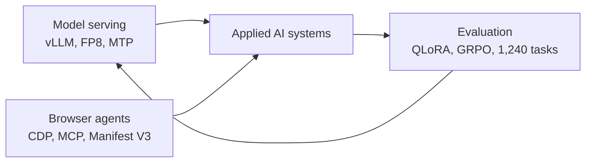

<picture>
  <source media="(prefers-reduced-motion: reduce) and (prefers-color-scheme: dark)" srcset="./assets/profile-dark/profile-focus-dark.png" />
  <source media="(prefers-reduced-motion: reduce)" srcset="./assets/profile/profile-focus.png" />
  <source media="(prefers-color-scheme: dark)" srcset="./assets/profile-dark/profile-focus-dark.gif" />
  
</picture>

# Muhammad Enrizky Brillian

**Software Engineer, AI and Automation Practice, IBM** · Toronto, ON

I build AI infrastructure and the tools around it: self-hosted model serving, browser agents, and data platforms that reach production.

[Portfolio](https://billy-enrizky.github.io/portfolio/) · [CV (PDF)](https://billy-enrizky.github.io/portfolio/assets/Muhammad-Enrizky-Brillian-Software-Engineer-CV.pdf) · [LinkedIn](https://www.linkedin.com/in/enrizky-brillian/) · [Email](mailto:billy.suharno@gmail.com)

## How the work connects

## Technical focus

-  **Model serving**: vLLM, SageMaker, FP8 weight compression, tensor parallelism, speculative decoding (MTP), and KV cache tuning.
-  **Browser agents**: raw Chrome DevTools Protocol, MCP servers, and Chrome Manifest V3 extensions.
-  **Applied AI**: QLoRA and GRPO fine-tuning, a six-agent text-to-SQL platform, and evaluation of structured outputs.
- **Data platforms**: BigQuery, Snowflake, ETL, Pandas, Terraform, and CI/CD.
- **Languages**: Python, SQL, TypeScript, JavaScript, R, and Rust.

## Experience

### Software Engineer, AI and Automation Practice

**IBM, Toronto · May 2025 to present**

- Deployed Gemma 4 31B as a self-hosted SageMaker endpoint with vLLM 0.32.0, FP8 weight compression and tensor parallelism. The deployment kept regulated data in the VPC and removed the managed-model dependency.
- Benchmarked a 31B vLLM deployment on eight A100 GPUs. Throughput reached 10,410.60 tokens per second at N=512 with zero errors at N=1024, and cost fell from $132.56 to $0.77 per million tokens, a 172x reduction.
- Ran 144/144 successful A/B runs of multi-token prediction across A10, A100-80GB, H100 and B200 GPUs. A10 was the only GPU with a durable MTP win, at 1.38x to 2.06x.
- Delivered a six-agent text-to-SQL platform with 93% accuracy across five production databases in eight weeks, enabling non-SQL staff to query operations data.
- Built a five-agent cross-cloud A2A platform with Entra ID JWT propagation, AWS Lambda SigV4, Bicep and Arize Phoenix. It has 124 unit tests and 16 RBAC roles, and it cut API calls 73%.
- Optimized H200 kernels for Muse Spark: 1.53x dense projection, 1.96x MoE W4A16, 1.90x attention decode and 1.77x decoder.

### Machine Learning Research Student (T-CAIREM Research Award)

**Toronto General Hospital, UHN · Sep 2024 to May 2026**

Supervised by Dr. Mamatha Bhat and Dr. Joseph S. Kim. Built a liver-failure survival model that reached 88.7% accuracy on research data from 1,260 patients across 32 US centers, and multimodal transplant research with early fusion of clinical text and histopathology features.

### Research Student, DSI Research Award

**University Health Network (UHN), KITE Research Institute · May 2024 to August 2024**

Human activity recognition with limited input data, supervised by Dr. Jose Zariffa. Research models recognized human actions with over 68% accuracy across different test settings.

### Data Scientist

**Sanofi, Toronto · January 2024 to August 2025**

Built a two-click Snowflake and Streamlit workflow that moved manual reporting from days to seconds, and led a cross-functional team that introduced sprint planning and CI/CD automation, supporting a 40% team productivity gain.

### Full Stack Developer Intern

**Leslie Dan Faculty of Pharmacy (LDFP), University of Toronto · May 2025 to August 2025**

Supervised by Professor Mina Tadrous. Built a paper-screening agent with OpenRouter, Gemini and OpenAI models, and a pharmacist-patient platform with NodeJS, ExpressJS, NextJS, React and TypeScript.

### Research Student

**Acceleration Consortium · May 2025 to August 2025**

Research tools extracted structured data from more than 10,000 document pages with 99.98% accuracy, producing more than 10,000 data rows with 22 fields each.

### Finance and Data Lab Assistant

**University of Toronto · May 2023 to December 2023**

A financial dashboard made three years of performance easier to review and compare across time.

### Teaching Assistant (Calculus, Data Science, Probability)

**University of Toronto · September 2023 to April 2026**

Taught calculus, data science and probability for 1,029+ hours, led tutorials for 30+ students, ran review seminars for 400+ students, and graded assessments for 650+ students.

### Research Assistant

**University of Toronto**

A university vision study reached 83% overall accuracy when evaluating object recognition and grasping together. A separate health project studied gendered health through tracking and body sensors.

### Big Data Analyst

**Kimia Farma · September 2022 to December 2022**

Built a branch sales database of 140,000+ entries and a Tableau sales dashboard, reducing data-processing time by 33%. The dashboard saved $95,000 in the annual budget.

### Data Analyst

**Mulia Health Dental Care Group · March 2022 to July 2022**

Customer-data analysis across 14 branches increased operational efficiency by 15%, using data from more than 10,000 customers. Recommendations informed initiatives that supported a 25% increase in company profitability.

## Selected projects

- **[OpenBrowser](https://github.com/billy-enrizky/openbrowser-ai)**: a Python framework that drives Chrome over raw CDP and runs LLM-written Python in a persistent namespace. It ships a CLI, a single-tool MCP server, a persistent daemon, a FastAPI and Next.js web app, and 14 LLM provider adapters. [CLI and MCP comparison](https://docs.openbrowser.me/comparison)
- **[Context Atlas](https://chromewebstore.google.com/detail/context-atlas-find-what-m/plehanpnecnjdbkcmbhgphhglkkkgfhd)** (Jev + Laya): a Manifest V3 Chrome extension that finds the sentence that answers a question on the current page and highlights it, with local search by default. [Read the article](https://openbrowser-landing.pages.dev/context-atlas-blog/)

## Research

- **[Multi-Token Prediction benchmark](https://openbrowser.me/mtp)**: 144/144 runs succeeded for Gemma 4 E2B-it at batch size 1 across A10, A100-80GB, H100 and B200 GPUs. The study separates engine gains from speculative-decoding gains.
- **Browser-in-the-Loop: Reinforcement Fine-Tuning LLM Agents for Web Form Filling** (STAD68 final paper, 2026): QLoRA and online GRPO raised the validation-task score from 0.614 to 0.670 (+9.1%) on 1,240 browser form tasks. These are benchmark results, not measured production savings.
- **Concentrate or Collapse: When Reinforcement Learning Meets Diffusion Language Models for Web Planning** (STAD80 course paper, 2026): compared Qwen3-8B, ReFusion-8B and FS-DFM-1.3B on 1,240 FormFactory tasks. FS-DFM scored 0/124 greedy despite 76.6% to 87.9% stochastic parser validity, which shows that parse-valid plans can still fail in a browser.

## Education and awards

- **University of Toronto**: Honours Bachelor of Science with High Distinction, June 2026. Data Science and Machine Learning Specialist, Computer Science major, Economics minor. CGPA 3.87/4.00.
- **Georgia Institute of Technology**: Master of Science in Computer Science, Artificial Intelligence Specialization, 2026 to present.
- **Awards**: Dean's List (2023 to 2025), T-CAIREM Research Award, and Advanced Indonesian Scholarship.
